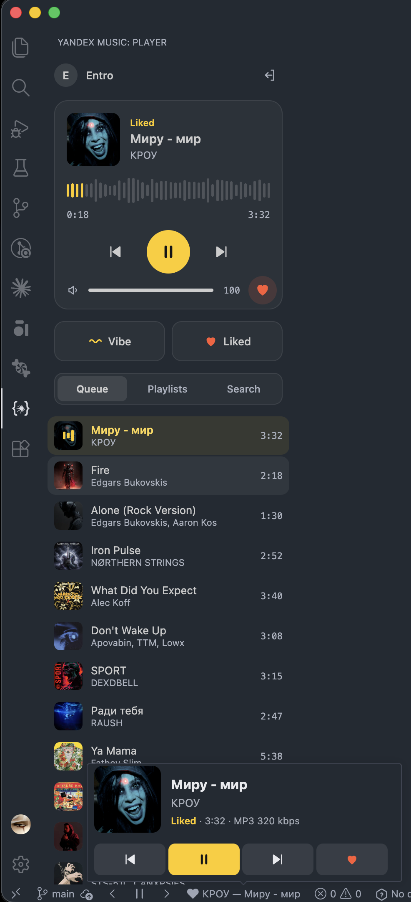

# Yandex Music for VS Code

Listen to Yandex Music without leaving the editor: My Vibe, your liked tracks,
playlists and search.



## Install

Install **Yandex Music Player** from the [Visual Studio Marketplace](https://marketplace.visualstudio.com/items?itemName=entro.vscode-yandex-music),
or search for it in the Extensions view, or run:

```bash
code --install-extension entro.vscode-yandex-music
```

Builds are also attached to [GitHub releases](https://github.com/entropious/vscode_music/releases)
as `.vsix` files: **Extensions → … → Install from VSIX…**

## Controls

- **Player panel** — the `{✷}` icon in the Activity Bar. Cover art, a waveform
  seek bar, volume, the queue, playlists and search. Search also finds genres:
  `rock`, `jazz` or `рок` puts up to three matching genre stations above the
  tracks, and clicking one starts endless radio of that genre, as My Vibe does.
  **Track radio** under the current track keeps it playing and fills the queue
  after it with endless music like it. **Liked** shows your liked tracks
  without touching the queue; Liked plays from the track you pick there. The
  button next to **Vibe** sets up My Vibe as on the site: character, mood and
  language (Russian, foreign or no words). While My Vibe plays, a change keeps
  the current track and replaces the tracks after it.
- **Status bar** — `‹ ▶ ›` buttons and the current track. Hover over the track
  or click it to open a mini player with previous, play/pause, next and like.
- **Keyboard shortcuts**

  | macOS | Windows / Linux | Action |
  |---|---|---|
  | `Cmd+Alt+P` | `Ctrl+Alt+P` | Play / pause |
  | `Cmd+Alt+→` | `Ctrl+Alt+→` | Next track |
  | `Cmd+Alt+←` | `Ctrl+Alt+←` | Previous track |

Every action is also available from the Command Palette under the
**Yandex Music** category.

## Signing in

Run **Yandex Music: Sign In** from the Command Palette.

- **In the browser.** The extension opens a separate Chrome, Yandex Browser,
  Edge or Brave window with the Yandex sign-in page, catches the redirect and
  exchanges the code for a token itself. That window keeps you signed in to
  Yandex, so the next sign-in is one click. Without a Chromium-based browser the
  page opens in your default browser; after signing in, paste the
  `music.yandex.ru/oauth?code=…` link from the browser history into VS Code.
- **With a token.** Paste an existing Yandex Music OAuth token.

The browser sign-in uses the same OAuth client as the Yandex Music desktop app
and asks only for music and basic account access. The token is kept in VS Code
SecretStorage, which is backed by the system keychain. On macOS the player
service also keeps a copy in the login keychain (item `vscode-yandex-music`), so
the fullscreen remote can start it without VS Code; signing out deletes it.

Full tracks need a Yandex Plus subscription; without it Yandex serves 30-second
previews. Tracks stream as MP3 at up to 320 kbps, and the mini player shows the
current codec and bitrate.

## Several VS Code windows

**macOS.** Music plays in a small background process, not in a window, so closing
or reloading a window doesn't interrupt it. Every window is a remote control
showing the same track, queue and progress. The process starts the first time you
play music and exits a few seconds after the last VS Code window closes.

**Windows and Linux.** Music plays in one window at a time; the others act as
remote controls. A command that starts playback moves the audio to the window it
came from once you have clicked inside that window's player panel — the webview
is only allowed to play sound after a click inside it. If the window that plays
music closes, another one picks up from the same track and position.

## Fullscreen remote (macOS)

**Yandex Music Remote** is a separate fullscreen app for a big screen: a large
cover with a spinning record, a background in the cover's colors, a waveform
progress bar and controls you can hit from across the room. It plays nothing
itself: it controls the player service that the extension runs on macOS, the
same way a VS Code window does, and starts that service itself when it isn't
running, so it works without VS Code open. The music keeps playing while the app
is open, even after VS Code is closed.

The `⛶` button in the player panel's title bar opens it, and so does **Yandex
Music: Open Fullscreen Remote**. The extension has to be installed and signed in
once. When the app isn't there yet, the button offers to install it: a terminal
runs `remote/scripts/install.sh` of this version, which builds the app on your
Mac from its source and puts it into `~/Applications`. That takes about 120 MB of
downloads, mostly Electron, and a few minutes, and installs [Bun](https://bun.sh)
if you have none. To update the app after the extension, run **Yandex Music:
Install Fullscreen Remote**, or the script yourself:

```
curl -fsSL https://raw.githubusercontent.com/entropious/vscode_music/main/remote/scripts/install.sh | bash
```

| Key | Action |
|---|---|
| `Space` | Play / pause |
| `←` / `→` | Previous / next track |
| `↑` / `↓` | Volume |
| `L` / `M` | Like / mute |
| `Q` / `/` | Queue / search |
| `F` | Leave or enter full screen |
| `V` | Bring the background video to the front, or put it back |

The remote has the same Liked list and My Vibe settings: **Liked** opens the list
in the side panel, and the button next to **Vibe** opens the settings.

Media keys keep working through the player service's Now Playing.

**Videos and genres.** Where a track has a video, the remote plays it without
sound, in this order:
1. its music video, which fills the background: a 30-second preview from the
   iTunes Store, or the video on YouTube that Wikidata or Genius links to,
   unless it is only the cover on a still frame (an auto-generated "Topic" or an
   "Official Audio" upload);
2. the track's video shot, Yandex Music's short looping video, in the cover's
   place;
3. the artist's background video from Yandex Music, or else the wide video on
   the artist's Apple Music page;
4. the album's motion cover from Apple Music, in the cover's place.

A video that fills the background brings up **Video** among the buttons at the
top: it shows the whole video over the player, with only the top bar and the
controls left, which fade out with the pointer, and puts it back in the background
when pressed again (or with `Esc`). The choice stays: while it is on, every next
video comes to the front at once, also after the app is restarted.

Next to the title, the album's genre starts that genre's radio. Videos and the
genre are looked up only while the remote's window is open and in sight, not
minimized or hidden. For the music videos the track's artist and title go to the
iTunes Search API, Wikidata and, once you give the extension a token, Genius,
which knows the most of them: create an API client at
[genius.com/api-clients](https://genius.com/api-clients), generate its Client
Access Token and enter it with **Yandex Music: Set Genius Token for Music
Videos** (VS Code keeps it with its secrets, the player service a copy in the
login keychain). For the motion covers and the artists' videos the album and the
artist are looked up on the iTunes Search API and their pages on
music.apple.com. Turn these off with
`yandexMusic.remote.musicVideos` and `yandexMusic.remote.motionCovers`. With
reduced motion turned on in macOS,
the remote plays no videos.

## AI-generated music

Tracks that Yandex Music labels as AI-generated get a mark in the player panel,
the queue and search results, the status bar, the mini player and the fullscreen
remote. The extension doesn't skip or dislike them; it only shows the mark. The
label is Yandex Music's own, the one in its "About the track" card: **AI** when
the rights holder says the track was made fully or partly with AI, **AI?** when
Yandex's detector found it was possibly made with AI. Hover over the mark for
which. No mark means only that Yandex hasn't labeled the track. The playing
track, the next ones in the queue and search results are looked up; turn this
off with `yandexMusic.aiLabels`.

## Settings

| Setting | Default | Description |
|---|---|---|
| `yandexMusic.quality` | `high` | `high` picks the highest MP3 bitrate available, `low` the lowest. |
| `yandexMusic.volume` | `0.7` | Volume, 0–1. |
| `yandexMusic.aiLabels` | `true` | Mark tracks that Yandex Music labels as AI-generated. |
| `yandexMusic.remote.musicVideos` | `true` | Fullscreen remote: music videos, silent, from the iTunes Store and YouTube via Wikidata and Genius. |
| `yandexMusic.remote.motionCovers` | `true` | Fullscreen remote: Apple Music's motion covers and artists' videos for tracks without a video. |

Source code, issues and building instructions are on
[GitHub](https://github.com/entropious/vscode_music); see
[DEVELOPMENT.md](https://github.com/entropious/vscode_music/blob/main/DEVELOPMENT.md)
for building and testing.

## Disclaimer

This is an unofficial client and is not affiliated with Yandex. It uses the
same undocumented API as the official apps, which may change at any time.
